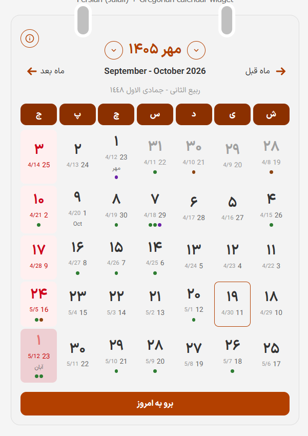
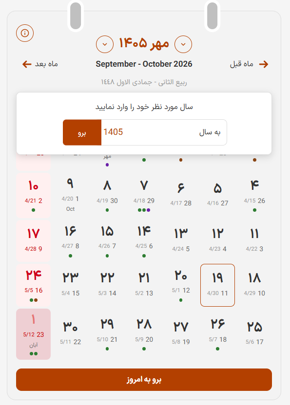
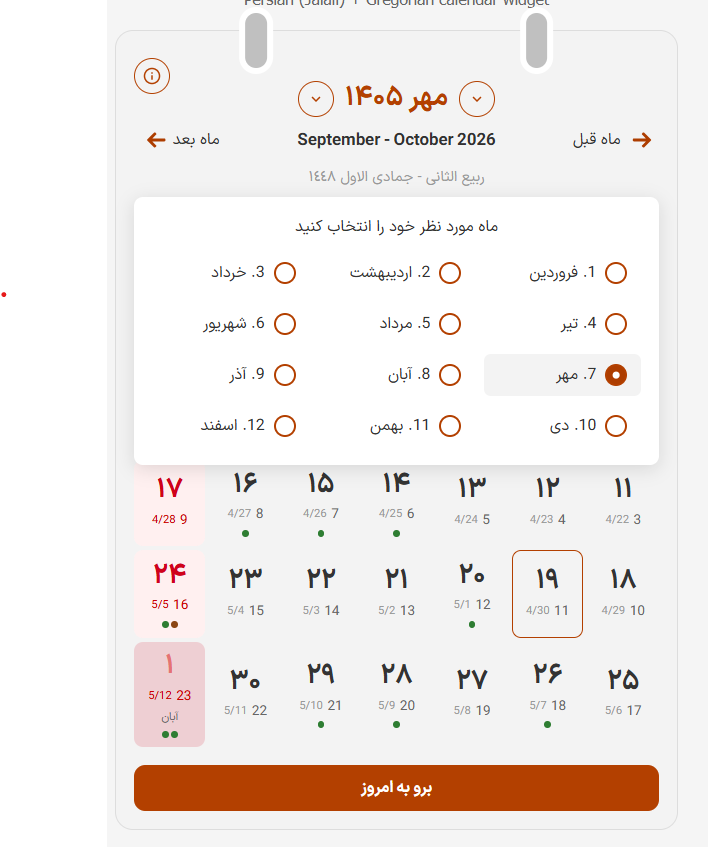
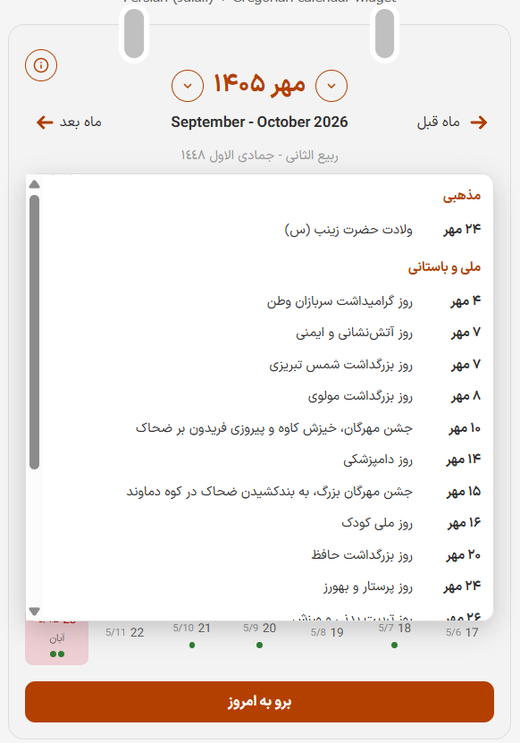

# dualcal

تقویم دوگانه فارسی (جلالی) + میلادی - یک کتابخانه TypeScript مستقل از فریم‌ورک.

---

## 📄 درباره این پروژه

این برنامه توسط **ایثار جانفزا** تهیه شده است.

## ❤️ حمایت از توسعه‌دهنده

در صورت تمایل جهت حمایت از من، می‌توانید هدیه‌ای را به شماره شبا زیر واریز کنید:

**شماره شبا:** `IR60017000000034348067607`

هر مبلغی به توسعه و بهبود این پروژه کمک می‌کند. سپاسگزارم! 🙏

---

## 📸 تصاویر






---

## ویژگی‌ها

- 📅 نمایش همزمان تاریخ جلالی و میلادی در هر سلول
- 🎨 طراحی زیبا به سبک تقویم رومیزی الهام گرفته از time.ir
- 🌙 پشتیبانی از حالت تاریک با CSS variables
- ⌨️ پشتیبانی کامل از کیبورد (فلش‌ها، Enter/Space، PageUp/PageDown)
- 🎯 قابلیت شخصی‌سازی تم با CSS variables
- 📋 پشتیبانی از تعطیلات با اعتبارسنجی و رویدادهای تکرار شونده
- 🔔 نقاط رویداد برای رویدادهای سفارشی
- 🌐 چیدمان راست‌چین (RTL) به صورت پیش‌فرض
- 📱 طراحی واکنش‌گرا
- 🏗️ مستقل از فریم‌ورک (کار با vanilla JS، React، Vue و غیره)
- 🧪 پوشش آزمایشی جامع
- 📦 بدون وابستگی‌های runtime (فقط peer dependency: `jalaali-js`)
- 🌙 پشتیبانی کامل از تعطیلات قمری با تقویم islamic-umalqura
- ℹ️ Popover مناسبت‌های ماه با دکمه info
- 🎭 گروه‌بندی مناسبت‌ها (تعطیلات، مذهبی، ملی، جهانی، تاریخی، شخصی)
- 🔢 سال نویس با پشتیبانی از کلید ENTER
- 🎨 استایل Material UI برای سال نویس

## نصب

```bash
npm install dualcal jalaali-js
```

## شروع سریع

```html
<!DOCTYPE html>
<html lang="fa" dir="rtl">
<head>
  <meta charset="UTF-8">
  <link rel="stylesheet" href="node_modules/dualcal/dist/dualcal.css">
</head>
<body>
  <div id="calendar"></div>

  <script type="module">
    import { createDualCalendar } from 'dualcal';

    const calendar = createDualCalendar(document.getElementById('calendar'), {
      holidays: [
        {
          date: '1405/07/20',
          calendar: 'jalali',
          title: 'تولد من',
          recurring: false,
          type: 'personal',
          holiday: true,
        },
      ],
      weekendDays: [5], // جمعه
      showHijri: true,
      gregorianDigits: 'latin',
      onDayClick: (date, jalaliDate) => {
        console.log('انتخاب شده:', date, jalaliDate);
      },
    });
  </script>
</body>
</html>
```

## API

### `createDualCalendar(container, options?)`

یک نمونه جدید از DualCalendar ایجاد می‌کند.

**پارامترها:**

- `container: HTMLElement` - المان DOM برای رندر تقویم
- `options?: DualCalendarOptions` - گزینه‌های پیکربندی

**بازگشت:** `DualCalendarInstance`

### گزینه‌ها

```typescript
interface DualCalendarOptions {
  holidays?: HolidayEntry[] | string;  // آرایه یا URL/رشته JSON
  weekendDays?: number[];               // پیش‌فرض: [5] (جمعه)
  initialDate?: Date | string;          // ISO میلادی یا جلالی "1405/07/20"
  events?: EventEntry[];                // رویدادهای سفارشی با نقاط
  theme?: Partial<DualCalTheme>;        // رنگ‌های تم سفارشی
  showHijri?: boolean;                  // پیش‌فرض: false
  gregorianDigits?: 'latin' | 'persian'; // پیش‌فرض: 'latin'
  monthListMode?: 'popover' | 'inline'; // پیش‌فرض: 'popover'
  onDayClick?: (date: Date, jalaliDate: JalaaliDate) => void;
  onMonthChange?: (jalaliDate: JalaaliDate) => void;
}
```

### متدهای نمونه

```typescript
instance.getDate(): Date;              // دریافت تاریخ فعلی
instance.goTo(date: Date | string);    // رفتن به تاریخ خاص
instance.goToToday();                  // رفتن به امروز
instance.next();                       // ماه بعد
instance.prev();                       // ماه قبل
instance.setHolidays(holidays);        // بروزرسانی تعطیلات
instance.setEvents(events);            // بروزرسانی رویدادها
instance.setTheme(theme);              // بروزرسانی تم
instance.destroy();                    // پاکسازی
```

## اسکیمای تعطیلات

```json
{
  "holidays": [
    {
      "date": "1405/07/20",
      "calendar": "jalali",
      "title": "تولد من",
      "recurring": false,
      "type": "personal",
      "holiday": true,
      "description": "توضیحات اختیاری"
    },
    {
      "date": "07/20",
      "calendar": "jalali",
      "title": "تولد من (سالانه)",
      "recurring": true,
      "type": "personal",
      "holiday": false
    },
    {
      "date": "2026-12-25",
      "calendar": "gregorian",
      "title": "Christmas",
      "recurring": false,
      "type": "international",
      "holiday": false
    },
    {
      "date": "01/10",
      "calendar": "hijri",
      "title": "عید سعید فطر",
      "recurring": true,
      "type": "religious",
      "holiday": true
    }
  ],
  "hijri": {
    "offset": 0,
    "monthStarts": {
      "1448-02": "2027-09-12"
    },
    "overrides": [
      {
        "hijri": "01/10",
        "date": "1405/12/05"
      }
    ]
  },
  "weekends": [5],
  "weekStart": 6
}
```

### فیلدهای تعطیلات

- `date`: تاریخ مناسبت (فرمت بسته به `calendar` متفاوت است)
- `calendar`: نوع تقویم - `"jalali"` (شمسی)، `"gregorian"` (میلادی)، یا `"hijri"` (قمری)
- `title`: عنوان مناسبت
- `recurring`: آیا تکرار شونده است؟ (برای تاریخ‌های دقیق غیرتکرار شونده `false`، برای تاریخ‌های ماه/روز `true`)
- `type`: نوع مناسبت - `"official"` (رسمی)، `"religious"` (مذهبی)، `"national"` (ملی و باستانی)، `"international"` (جهانی)، `"historical"` (تاریخی)، یا `"personal"` (شخصی)
- `holiday`: آیا روز تعطیل است؟ (اگر `true` باشد، سلول قرمز می‌شود)

### Popover مناسبت‌های ماه

با گزینه `monthListMode: 'popover'` (پیش‌فرض)، یک دکمه "i" در گوشه تقویم نمایش داده می‌شود که با کلیک روی آن، popover مناسبت‌های ماه باز می‌شود. مناسبت‌ها به صورت گروه‌بندی شده نمایش داده می‌شوند:

- تعطیلات (رنگ قرمز)
- مذهبی
- ملی و باستانی
- جهانی
- تاریخی
- شخصی

برای نمایش لیست قدیمی زیر تقویم، از `monthListMode: 'inline'` استفاده کنید.

### پشتیبانی از تعطیلات قمری

تعطیلات قمری با `"calendar": "hijri"` و فرمت `"date": "MM/DD"` (ماه/روز قمری) تعریف می‌شوند. این تعطیلات همیشه تکرار شونده هستند و با استفاده از `Intl.DateTimeFormat` مرورگر با تقویم `islamic-umalqura` با هر روز میلادی قابل مشاهده تطبیق داده می‌شوند.

**مهم:** تاریخ‌های قمری رسمی ایران به رویت ماه بستگی دارد و هر سال ممکن است تغییر کند. پیاده‌سازی تقویم قمری `Intl` ممکن است ۱-۲ روز با تقویم رسمی ایران اختلاف داشته باشد. شما باید هر سال تاریخ‌های قمری را بررسی کنید و از تنظیمات `monthStarts` و `overrides` برای هماهنگی با منابع رسمی استفاده کنید.

**پیکربندی قمری:**

- `hijri.offset`: تعداد روز آفست برای محاسبات قمری (مثلاً `+1` برای جلو بردن همه تعطیلات قمری یک روز)
- `hijri.monthStarts`: نقشه اختیاری برای دقت بیشتر - کلید فرمت `"YYYY-MM"` (ماه قمری) و مقدار تاریخ شروع میلادی ISO (مثلاً `"1448-02": "2027-09-12"`). اگر یک ماه در این نقشه نباشد، از `Intl` به عنوان fallback استفاده می‌شود.
- `hijri.overrides`: آرایه‌ای از overrideها برای پین کردن تعطیلات قمری خاص به تاریخ‌های دقیق برای یک سال. overrideها از فرمت `{ "hijri": "MM/DD", "date": "YYYY/MM/DD" }` استفاده می‌کنند که `date` می‌تواند فرمت جلالی یا ISO میلادی باشد. overrideها تطبیق محاسبه‌شده قمری را برای آن سال حذف می‌کنند.

## شخصی‌سازی تم

تمام رنگ‌ها به عنوان CSS variables در دسترس هستند:

```css
:root {
  --dc-outer-bg: #F3F3F3;
  --dc-header-color: #B34000;
  --dc-holiday-bg: #FFF0F7;
  --dc-today-border: #B34000;
  /* ... و بسیاری دیگر */
}
```

یا به صورت برنامه‌نویسی:

```typescript
calendar.setTheme({
  headerColor: '#FF6B35',
  holidayBg: '#FFE5E5',
});
```

## پشتیبانی مرورگر

- Chrome/Edge: آخرین نسخه
- Firefox: آخرین نسخه
- Safari: آخرین نسخه
- نیاز به پشتیبانی ES2020+

## مجوز

MIT

## مشارکت

مشارکت‌ها خوش‌آمد هستند! لطفاً قبل از ارسال PR، راهنمای مشارکت ما را مطالعه کنید.

## قدردانی‌ها

- محاسبات تاریخ با قدرت [jalaali-js](https://github.com/jalaali/jalaali-js)
- طراحی الهام گرفته از [time.ir](https://www.time.ir/)

---

# English Version

Persian (Jalali) + Gregorian calendar widget - A framework-agnostic vanilla TypeScript library.

## 📄 About This Project

This program was created by **Eytar Janfaza**.

## ❤️ Support the Developer

If you'd like to support me, you can send a donation to the following bank account:

**IBAN:** `IR60017000000034348067607`

Any amount helps with the development and improvement of this project. Thank you! 🙏

---

## 📸 Screenshots

<div style="display: flex; gap: 10px; flex-wrap: wrap;">
  <a href="photo/1.png" target="_blank"></a>
  <a href="photo/2.png" target="_blank"></a>
  <a href="photo/3.png" target="_blank"></a>
  <a href="photo/4.png" target="_blank"></a>
</div>

---

## Features

- 📅 Dual calendar display: Jalali (Persian) and Gregorian dates shown together in every cell
- 🎨 Beautiful desk-calendar design inspired by time.ir
- 🌙 Dark mode support via CSS variables and `prefers-color-scheme`
- ⌨️ Full keyboard navigation (arrows, Enter/Space, PageUp/PageDown)
- 🎯 Customizable themes with CSS variables
- 📋 Holiday support with validation and recurring events
- 🔔 Event dots for custom events
- 🌐 RTL layout by default
- 📱 Responsive design
- 🏗️ Framework-agnostic (works with vanilla JS, React, Vue, etc.)
- 🧪 Comprehensive test coverage
- 📦 Zero runtime dependencies (only peer dependency: `jalaali-js`)
- 🌙 Full Hijri (lunar) holiday support with islamic-umalqura calendar
- ℹ️ Info button popover for monthly holidays
- 🎭 Holiday grouping (official, religious, national, international, historical, personal)
- 🔢 Year input with ENTER key support
- 🎨 Material UI-style year dropdown

## Installation

```bash
npm install dualcal jalaali-js
```

## Quick Start

```html
<!DOCTYPE html>
<html lang="fa" dir="rtl">
<head>
  <meta charset="UTF-8">
  <link rel="stylesheet" href="node_modules/dualcal/dist/dualcal.css">
</head>
<body>
  <div id="calendar"></div>

  <script type="module">
    import { createDualCalendar } from 'dualcal';

    const calendar = createDualCalendar(document.getElementById('calendar'), {
      holidays: [
        {
          date: '1405/07/20',
          calendar: 'jalali',
          title: 'تولد من',
          recurring: false,
          type: 'personal',
          holiday: true,
        },
      ],
      weekendDays: [5], // Friday
      showHijri: true,
      gregorianDigits: 'latin',
      onDayClick: (date, jalaliDate) => {
        console.log('Selected:', date, jalaliDate);
      },
    });
  </script>
</body>
</html>
```

## API

### `createDualCalendar(container, options?)`

Creates a new DualCalendar instance.

**Parameters:**

- `container: HTMLElement` - The DOM element to render the calendar into
- `options?: DualCalendarOptions` - Configuration options

**Returns:** `DualCalendarInstance`

### Options

```typescript
interface DualCalendarOptions {
  holidays?: HolidayEntry[] | string;  // Array or URL/JSON string
  weekendDays?: number[];               // Default: [5] (Friday)
  initialDate?: Date | string;          // Gregorian ISO or Jalali "1405/07/20"
  events?: EventEntry[];                // Custom events with dots
  theme?: Partial<DualCalTheme>;        // Custom theme colors
  showHijri?: boolean;                  // Default: false
  gregorianDigits?: 'latin' | 'persian'; // Default: 'latin'
  monthListMode?: 'popover' | 'inline'; // Default: 'popover'
  onDayClick?: (date: Date, jalaliDate: JalaaliDate) => void;
  onMonthChange?: (jalaliDate: JalaaliDate) => void;
}
```

### Instance Methods

```typescript
instance.getDate(): Date;              // Get current date
instance.goTo(date: Date | string);    // Go to specific date
instance.goToToday();                  // Go to today
instance.next();                       // Next month
instance.prev();                       // Previous month
instance.setHolidays(holidays);        // Update holidays
instance.setEvents(events);            // Update events
instance.setTheme(theme);              // Update theme
instance.destroy();                    // Clean up
```

## Holiday Schema

```json
{
  "holidays": [
    {
      "date": "1405/07/20",
      "calendar": "jalali",
      "title": "تولد من",
      "recurring": false,
      "type": "personal",
      "holiday": true,
      "description": "Optional description"
    },
    {
      "date": "07/20",
      "calendar": "jalali",
      "title": "تولد من (سالانه)",
      "recurring": true,
      "type": "personal",
      "holiday": false
    },
    {
      "date": "2026-12-25",
      "calendar": "gregorian",
      "title": "Christmas",
      "recurring": false,
      "type": "international",
      "holiday": false
    },
    {
      "date": "01/10",
      "calendar": "hijri",
      "title": "عید سعید فطر",
      "recurring": true,
      "type": "religious",
      "holiday": true
    }
  ],
  "hijri": {
    "offset": 0,
    "monthStarts": {
      "1448-02": "2027-09-12"
    },
    "overrides": [
      {
        "hijri": "01/10",
        "date": "1405/12/05"
      }
    ]
  },
  "weekends": [5],
  "weekStart": 6
}
```

### Holiday Fields

- `date`: The holiday date (format depends on `calendar`)
- `calendar`: Calendar type - `"jalali"` (Persian), `"gregorian"` (Gregorian), or `"hijri"` (lunar)
- `title`: Holiday title
- `recurring`: Whether it repeats (use `false` for exact dates, `true` for month/day patterns)
- `type`: Holiday type - `"official"`, `"religious"`, `"national"`, `"international"`, `"historical"`, or `"personal"`
- `holiday`: Whether the day is a holiday (if `true`, the cell is colored red)

### Monthly Holiday Popover

With `monthListMode: 'popover'` (default), an "i" button appears in the calendar corner. Clicking it opens a popover showing the month's holidays, grouped by type:

- Holidays (red)
- Religious
- National & Historical
- International
- Historical
- Personal

To show the old inline list below the calendar, use `monthListMode: 'inline'`.

### Hijri (Lunar) Holiday Support

Hijri holidays are defined with `"calendar": "hijri"` and use `"date": "MM/DD"` format (Hijri month/day). These are always recurring and are matched against each visible Gregorian day using the browser's `Intl.DateTimeFormat` with the `islamic-umalqura` calendar.

**Important:** Iran's official lunar dates depend on moon sighting each year. The `Intl` Islamic calendar implementation may differ by 1-2 days from the official Iranian calendar. You should verify lunar dates annually and use the `monthStarts` and `overrides` configuration to align with official sources.

**Hijri Configuration:**

- `hijri.offset`: Day offset to apply to Hijri calculations (e.g., `+1` to shift all Hijri holidays forward by one day)
- `hijri.monthStarts`: Optional precision map - key is `"YYYY-MM"` (Hijri month) and value is Gregorian ISO start date (e.g., `"1448-02": "2027-09-12"`). If a month is not in this map, `Intl` is used as fallback.
- `hijri.overrides`: Array of overrides to pin specific Hijri holidays to exact dates for a year. Overrides use the format `{ "hijri": "MM/DD", "date": "YYYY/MM/DD" }` where `date` can be either Jalali or Gregorian ISO format. Overrides suppress the computed Hijri match for that year.

## Theme Customization

All colors are exposed as CSS variables:

```css
:root {
  --dc-outer-bg: #F3F3F3;
  --dc-header-color: #B34000;
  --dc-holiday-bg: #FFF0F7;
  --dc-today-border: #B34000;
  /* ... and many more */
}
```

Or programmatically:

```typescript
calendar.setTheme({
  headerColor: '#FF6B35',
  holidayBg: '#FFE5E5',
});
```

## Browser Support

- Chrome/Edge: Latest
- Firefox: Latest
- Safari: Latest
- Requires ES2020+ support

## License

MIT

## Contributing

Contributions are welcome! Please read our contributing guidelines before submitting PRs.

## Acknowledgments

- Date calculations powered by [jalaali-js](https://github.com/jalaali/jalaali-js)
- Design inspired by [time.ir](https://www.time.ir/)
