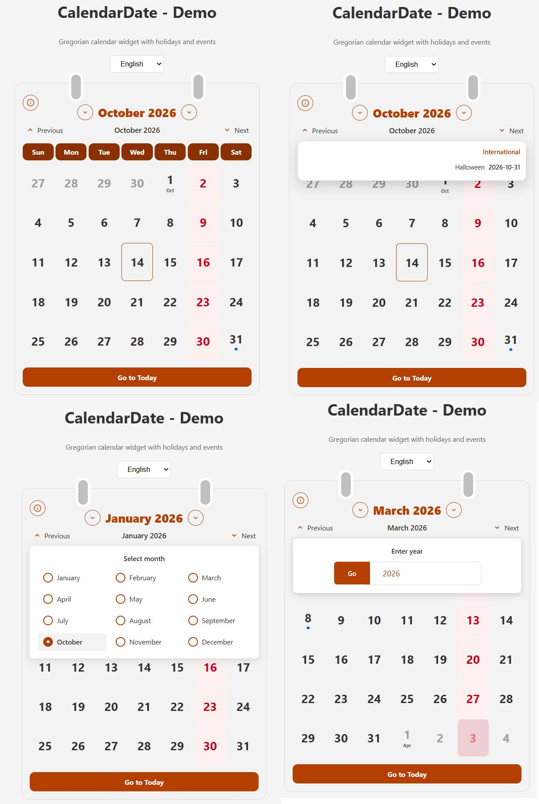

# CalendarDate

Gregorian calendar widget - A framework-agnostic vanilla TypeScript library for displaying holidays and events.

---

## 📄 About This Project

This program was created by **Isar Janfaza**.

## 📸 Screenshots

<div style="display: grid; grid-template-columns: repeat(auto-fit, minmax(200px, 1fr)); gap: 10px;">
  <a href="photo/combined_calendar.jpg" target="_blank"></a>
</div>

---

## Features

- 📅 Gregorian calendar display with holidays and events
- � Multi-language support (English, French, German)
- �🎨 Beautiful desk-calendar design
- 🌙 Dark mode support via CSS variables and `prefers-color-scheme`
- ⌨️ Full keyboard navigation (arrows, Enter/Space, PageUp/PageDown)
- 🎯 Customizable themes with CSS variables
- 📋 Holiday support with validation and recurring events
- 🔔 Event dots for custom events
- 📱 Responsive design
- 🏗️ Framework-agnostic (works with vanilla JS, React, Vue, etc.)
- 🧪 Comprehensive test coverage
- 📦 Zero runtime dependencies
- ℹ️ Info button popover for monthly holidays
- 🎭 Holiday grouping (official, religious, national, international, historical, personal)
- 🔢 Year input with ENTER key support
- 🎨 Material UI-style year dropdown
- 🔀 Navigation arrows on month controls

## Installation

```bash
npm install calendardate
```

## Quick Start

```html
<!DOCTYPE html>
<html lang="en">
<head>
  <meta charset="UTF-8">
  <link rel="stylesheet" href="node_modules/calendardate/dist/dualcal.css">
</head>
<body>
  <div id="calendar"></div>

  <script type="module">
    import { createDualCalendar } from 'calendardate';

    const calendar = createDualCalendar(document.getElementById('calendar'), {
      holidays: [
        {
          date: '2026-07-20',
          calendar: 'gregorian',
          title: 'My Birthday',
          recurring: false,
          type: 'personal',
          holiday: true,
        },
      ],
      weekendDays: [5], // Friday (5 = Friday in JS Date: 0=Sun, 1=Mon, ..., 5=Fri, 6=Sat)
      locale: 'en', // Available: 'en', 'fr', 'de'
      onDayClick: (date) => {
        console.log('Selected:', date);
      },
    });
  </script>
</body>
</html>
```

## API

### `createDualCalendar(container, options?)`

Creates a new DualCalendar instance.

**Parameters:**

- `container: HTMLElement` - The DOM element to render the calendar into
- `options?: DualCalendarOptions` - Configuration options

**Returns:** `DualCalendarInstance`

### Options

```typescript
interface DualCalendarOptions {
  holidays?: HolidayEntry[] | string;  // Array or URL/JSON string
  weekendDays?: number[];               // Default: [5] (Friday, in JS Date: 0=Sun, 1=Mon, ..., 5=Fri, 6=Sat)
  initialDate?: Date | string;          // Gregorian ISO format
  events?: EventEntry[];                // Custom events with dots
  theme?: Partial<DualCalTheme>;        // Custom theme colors
  monthListMode?: 'popover' | 'inline'; // Default: 'popover'
  locale?: 'en' | 'fr' | 'de';         // Default: 'en'
  onDayClick?: (date: Date) => void;
  onMonthChange?: (grid: CalendarGrid) => void;
}
```

### Instance Methods

```typescript
instance.getDate(): Date;              // Get current date
instance.goTo(date: Date | string);    // Go to specific date
instance.goToToday();                  // Go to today
instance.next();                       // Next month
instance.prev();                       // Previous month
instance.setHolidays(holidays);        // Update holidays
instance.setEvents(events);            // Update events
instance.setTheme(theme);              // Update theme
instance.destroy();                    // Clean up
```

## Holiday Schema

```json
{
  "holidays": [
    {
      "date": "2026-07-20",
      "calendar": "gregorian",
      "title": "My Birthday",
      "recurring": false,
      "type": "personal",
      "holiday": true,
      "description": "Optional description"
    },
    {
      "date": "07/20",
      "calendar": "gregorian",
      "title": "My Birthday (Annual)",
      "recurring": true,
      "type": "personal",
      "holiday": false
    },
    {
      "date": "12/25",
      "calendar": "gregorian",
      "title": "Christmas",
      "recurring": true,
      "type": "international",
      "holiday": true
    }
  ],
  "weekends": [5], // Friday (5 = Friday in JS Date: 0=Sun, 1=Mon, ..., 5=Fri, 6=Sat)
  "weekStart": 0
}
```

### Holiday Fields

- `date`: The holiday date (ISO format `YYYY-MM-DD` for exact dates, `MM/DD` for recurring)
- `calendar`: Calendar type - `"gregorian"` only
- `title`: Holiday title
- `recurring`: Whether it repeats (use `false` for exact dates, `true` for month/day patterns)
- `type`: Holiday type - `"official"`, `"religious"`, `"national"`, `"international"`, `"historical"`, or `"personal"`
- `holiday`: Whether the day is a holiday (if `true`, the cell is colored red)

### Monthly Holiday Popover

With `monthListMode: 'popover'` (default), an "i" button appears in the calendar corner. Clicking it opens a popover showing the month's holidays, grouped by type:

- Holidays (red)
- Religious
- National & Historical
- International
- Historical
- Personal

To show the old inline list below the calendar, use `monthListMode: 'inline'`.

## Internationalization (i18n)

CalendarDate supports multiple languages out of the box. You can set the `locale` option to display the calendar in different languages.

### Supported Languages

- `en` - English (default)
- `fr` - French
- `de` - German

### Usage

```typescript
const calendar = createDualCalendar(container, {
  locale: 'fr', // or 'en', 'de'
  // ... other options
});
```

### Adding Custom Translations

You can also add custom translations by extending the translation system:

```typescript
import { getTranslations } from 'calendardate';

// Access current translations
const t = getTranslations('en');
console.log(t.months.full); // ['January', 'February', ...]
```

All UI text including month names, weekdays, navigation buttons, and holiday categories are translated based on the selected locale.

## Theme Customization

All colors are exposed as CSS variables:

```css
:root {
  --dc-outer-bg: #F3F3F3;
  --dc-header-color: #B34000;
  --dc-holiday-bg: #FFF0F7;
  --dc-today-border: #B34000;
  /* ... and many more */
}
```

Or programmatically:

```typescript
calendar.setTheme({
  headerColor: '#FF6B35',
  holidayBg: '#FFE5E5',
});
```

## Browser Support

- Chrome/Edge: Latest
- Firefox: Latest
- Safari: Latest
- Requires ES2020+ support

## License

MIT

## Contributing

Contributions are welcome! Please read our contributing guidelines before submitting PRs.
